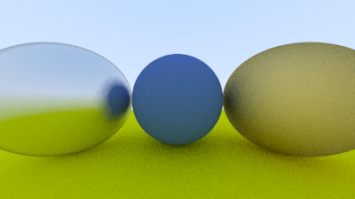

# rayfuck

A ray tracer written in Brainfuck, made by compiling Ray Tracing in One Weekend's C code into Brainfuck using a simple IR.
The accompanying blog can be found [here](http://epestr.com/blog/writing-a-ray-tracer-in-brainfuck). 

[Brainjoin](https://github.com/mTvare6/brainjoin) lets this ray tracer run without taking days, and the binary is left here with a speedup of more than 216,000× over the base running at 40s. A copy at `./bf`

There is also another compiler from [Daniel Angell's blog post](https://danangell.com/blog/posts/brainfuck-ray-tracer-optimization/), which reports a 9,000× speedup over his existing base running at 80s.

Both runtime in Intel Core Ultra 9 185H.

Brainfuck render:

compared to the C render:

